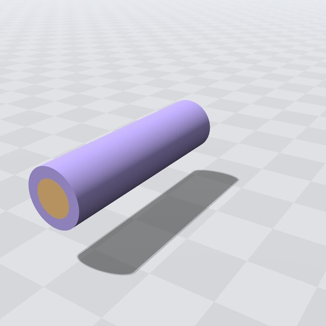

.. _Chap:ExampleLanguage:

Language
========

``Examples/Language`` reads a model from text: a cable, a copper core inside a PTFE jacket, in a box of air with a
flow across it, written in the :ref:`Chap:Language`. ``cable/model.ebg`` holds the geometry (the shapes, the overlay of
regions with their materials, the box's faces labeled ``inlet``, ``outlet``, ``far`` and ``ends``), ``cable/setup.ebg``
the materials' properties, two domains (electrostatics, and cfd, the air with four surface groups) and the couplings
between them.

The program reads the folder at run time with ``Language::read()``, compiles the object into a tape, builds the cfd
domain for that tape from the model's setup, and fills a table of its own rows (a density and a viscosity per
subdomain) from the subdomains' properties, in the tape's pool. ``completeness()`` reports whether every subdomain has
properties and every piece of surface bounding the domain is in a surface group. A query reads the fluid's density by
the domain's label at a point, on the host and, through ``GPU::transform``, on a GPU. The window shows the regions,
colored by material, with the model's names; its panel switches between the two domains.

   The cable in its box of air, the air hidden, colored by material.

See :ref:`Chap:ImplemLanguage` for the calls, and ``Examples/Language/README.md`` for building it.
