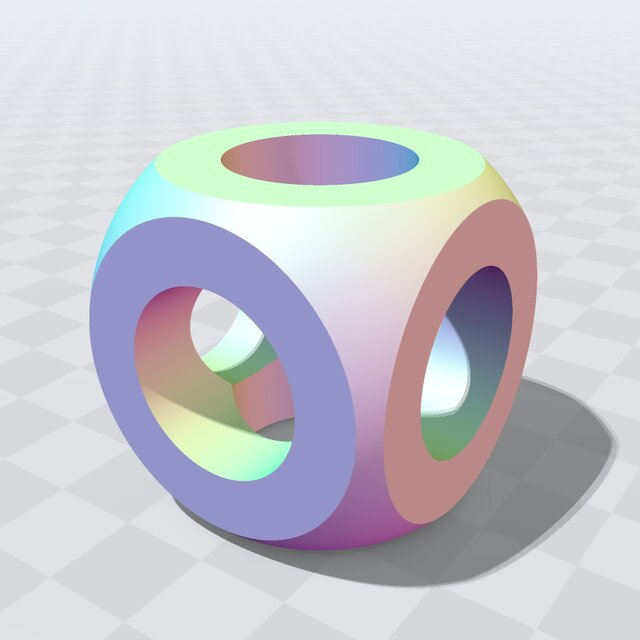

.. _Chap:ExampleLanguageCSG:

Language CSG
============

``Examples/LanguageCSG`` reads a composition written in the :ref:`Chap:Language` at run time: the classic CSG
solid of :ref:`Chap:ExampleBasicCSG`, a cube rounded off by a ball and drilled through along all three axes. The
source is at :file:`Examples/LanguageCSG/main.cpp`, and the model is :file:`Examples/LanguageCSG/solid.ebg`.

   The solid as the viewer first shows it.

The model
---------

``solid.ebg`` gives the solid's sizes as params, defines the cube, the ball and the three drills, and makes the
object of them:

.. code-block:: text

   param r_drill = 0.55
   ...
   object difference(intersection(cube, ball), drills)

See :ref:`Chap:LanguageShapes` and :ref:`Chap:LanguageOperations` for every shape and operation.

Reading it and compiling it
---------------------------

``Language::read()`` reads the file into a model; a model with errors throws them all, with their files, lines and
columns. The model's object is an ``Expr``, as the expression builder makes one, and compiles into a tape like any other:

.. code-block:: c++

   Pool pool(hostMemoryResource());

   const auto    model = Language::read<T>("solid.ebg", pool);
   const Tape<T, TapeFeature::Weld> tape(pool, model.object(), model.tapeOptions());

From here on, nothing knows the solid came from a file: the program opens a window on the tape, which renders on the
GPU in a GPU build, and the tape runs queries there as any tape does (see :ref:`Chap:ExampleBasicCSG`).

Editing ``solid.ebg`` changes the solid with no compiling: run the program again. ``ebgstudio`` (built in
``Studio/``, see :ref:`Chap:Studio`) opens the model in a window that reloads it on every save,
``ebgstudio solid.ebg``. :ref:`Chap:ExampleLanguageDomains` goes on to a model with regions, materials and domains.

Building and running
--------------------

Build it as any example (see :ref:`Chap:Examples`), and run it from its folder, where ``solid.ebg`` is:

.. code-block:: bash

   cd Examples/LanguageCSG
   make && ./LanguageCSG.ex                 # or ./LanguageCSG.ex path/to/model.ebg

See :ref:`Chap:ImplemLanguage` for the calls.
