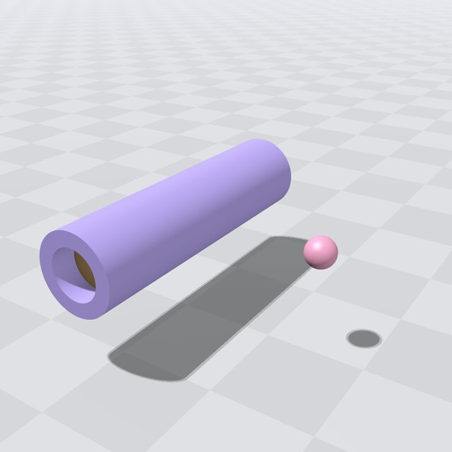

.. _Chap:ExampleLanguageDomains:

Language domains
================

``Examples/LanguageDomains`` reads a model written in the :ref:`Chap:Language` at run time: the cable of
:ref:`Chap:Language`'s first model, a copper core inside a PTFE jacket, and a steel sensor downstream, in a box of
air with a flow across it.
The source is at :file:`Examples/LanguageDomains/main.cpp`, and the model in :file:`Examples/LanguageDomains/cable/`. Reading a model and
compiling its object are shown on their own in :ref:`Chap:ExampleLanguageCSG`.

   The cable and the sensor in their box of air, the air hidden, colored by material.

The model
---------

``cable/model.ebg`` holds the geometry: the shapes, the overlay of regions with their materials, and the box's
faces labeled ``inlet``, ``outlet``, ``far`` and ``ends``. ``cable/setup.ebg`` includes it and holds the
materials' properties, three domains (electrostatics, in the jacket and the air; cfd, the air with six surface
groups; and conduction, in the core and the jacket) and the couplings between them. Both are shown and explained
in :ref:`Chap:Language`.

Reading it
----------

The program reads ``cable/setup.ebg`` with ``Language::read()``, which also reads what it includes; a model with
errors throws them all, with their files, lines and columns. It then compiles the object into a tape, builds
the cfd domain for that tape from the model's setup, and checks it with ``completeness()``.

The pieces of the fluid
-----------------------

The check works from the description, which cannot say how many pieces of space the fluid is in. The program asks
the geometry, with ``connectedComponents()`` on the cfd domain at a resolution of 0.05 over the air box: each
connected component of the fluid, with a point in it, its volume and whether it reaches the box (see
:ref:`Chap:ImplemRegions`). The fluid is one piece: the cable lies wholly inside the air box, so the air in each
end of the jacket, between the core's end and the jacket's end, opens onto the rest of the air. Had the cable
reached the box's faces, the air in its ends would have met the rest only through those faces, and the fluid would
have been three pieces, two of them small pockets open only on the domain's boundary: what this check is for.

What a solver keeps
-------------------

The language passes properties through unread, so the program says what they mean: a row of its own type,
``Fluid``, a density and a viscosity, filled from each subdomain's properties into a ``Language::Table`` in the
tape's pool. The subdomain's properties are its own over its regions' material's, so the air's density comes
from the ``air`` material.

A domain on its own
-------------------

Conduction computes in the cable alone, so its solver needs no more than the cable and what touches it.
``model.domainObject("conduction")`` gives the domain's own object: the core and the jacket, and the regions whose
bounding boxes meet theirs, here the air around the cable. The sensor is dropped: its box lies apart from the
cable's, downstream in the flow. The program compiles that object into a tape of its own and builds the domain
for it from the translated setup, with the same subdomains, and prints which regions were kept.

The air is kept although the cable's solver does not compute in it: its box holds the cable's, and it is what the
cable's surface faces. This is why the flow and electrostatics, which compute in the air, keep every region: the
air's box holds them all. The rule, and why a box may keep a region that does not touch, is on
:ref:`Chap:ImplemRegions`.

On the host and on a GPU
------------------------

A query reads the fluid's density at a point, by the domain label there, along a line across the cable: on
the host, then the same through ``GPU::transform``, after the pool is mirrored to the device. Last, the window
shows the regions, colored by material, with the model's names; its panel switches between the three domains.
The window is given every domain's own shape too: with conduction shown alone (its ``[Only]``), the cost views
(M) time the cable's own tape (see :ref:`Chap:Viewer`).

Editing the files changes the model with no compiling: run the program again. ``ebgstudio`` (built in
``Studio/``, see :ref:`Chap:Studio`) checks it, ``ebgstudio check cable/setup.ebg --domain cfd``, and opens it in a
window that reloads it on every save, ``ebgstudio cable/setup.ebg``.

Building and running
--------------------

Build it as any example (see :ref:`Chap:Examples`), and run it from its folder, where ``cable/`` is:

.. code-block:: bash

   cd Examples/LanguageDomains
   make && ./LanguageDomains.ex                    # or ./LanguageDomains.ex path/to/setup.ebg

See :ref:`Chap:ImplemLanguage` for the calls.
