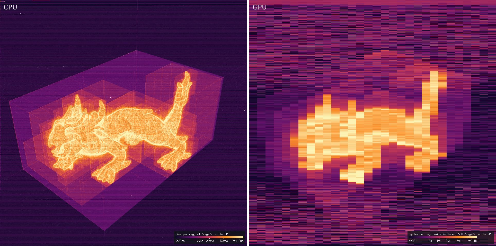

.. _Chap:ImplemRender:

The renderer and the viewer
===========================

The renderer is in `EBGeometry_Render.hpp <doxygen/html/EBGeometry__Render_8hpp.html>`__ and the window
in `EBGeometry_Viewer.hpp <doxygen/html/EBGeometry__Viewer_8hpp.html>`__; ``EBGeometry.hpp`` includes
both. Every ray it casts is a ``firstHit()`` on the shape (see :ref:`Chap:ImplemRays`), so it renders any
shape, exactly where the shape has a ray form; the depth view and the cost of ``firstCrossing()`` use
``firstCrossing()``. :ref:`Chap:Rendering` describes the method.

.. contents:: On this page
   :local:
   :depth: 1

The renderer
------------

The classes are in namespace ``Render``:

.. code-block:: c++

   Render::Settings<T> settings;                       // 960 x 960, 2 x 2 rays per pixel, ...
   settings.m_colorBy = Render::ColorBy::Primitive;

   const Render::Renderer<T> renderer(settings);
   const auto                camera = Render::Camera<T>::fit(shape.computeBoundingVolume());

   Render::Image       image;                          // 0xRRGGBBAA, row by row from the top
   const Render::Stats stats = renderer.render(shape, camera, image);

* `Camera <doxygen/html/structEBGeometry_1_1Render_1_1Camera.html>`__ orbits a target: yaw about the
  up axis (+y by default), pitch above the horizontal plane, a distance and a vertical field of view.
  ``Camera::fit(box)`` aims it at a box from far enough to see all of it, and ``Camera::fit(box, view)``
  does so from a named direction (``View::Front``, ``Back``, ``Left``, ``Right``, ``Top`` or ``Bottom``;
  the pitch may be 90 degrees, straight along the up axis); ``Camera::lookAt(eye, target)`` places it
  directly. ``m_orthographic`` makes the rays parallel, the view as tall as the perspective view at the
  target, and ``m_nearClip`` starts every camera ray that far from the eye. A shape with an unbounded box
  (a plane, a complement) has nothing to fit; give it a camera, or fit the camera to a box of your own.
* `Settings <doxygen/html/structEBGeometry_1_1Render_1_1Settings.html>`__ is a plain value: the image
  size and rays per pixel, the host threads, shadows, ambient occlusion, the floor (with or without its
  checkerboard, and the checker's size) and the sky (its horizon and zenith colors, or a plain
  background), how to color (``ColorBy::Normal``, the default, ``ColorBy::Uniform`` or
  ``ColorBy::Primitive``), the colors, the light (its direction, by default in the camera's frame so that
  it turns with the camera and lights the side in view, or in the scene with ``m_lightFromCamera`` false;
  its intensity, the ambient level, and the highlights' strength and shininess), the section plane
  (``m_section``, a point and a normal; the side the normal points to is removed; ``m_isoSpacing`` draws lines of equal distance on it; the cut face is
  colored as a surface facing along the plane's normal would be, opaque unless ``m_cutOpacity`` is below 1, when the shape's
  next surface behind it shows through; its contour, a line
  ``m_contourWidth`` pixels wide, and a sheet of opacity ``m_sheetOpacity`` outside the shape within its
  box; for a view of regions the plane is filled instead by the material of each point's region, in the material's
  color (``m_sectionFill``, ``m_materialColors``), gray where the region has none or a domain shown on the plane does
  not compute), and the march (``RayOptions``). ``m_primitiveColors`` gives the first
  ``Settings::PrimitiveColors`` (16) primitive ids colors of their own; an entry left unset, and every
  later id, takes the built-in palette's (:ref:`Chap:ExampleSurfaceLabels` colors its bore steel gray).
  ``m_highlightPrimitive`` tints one primitive's surface in ``m_highlightColor``. ``m_viewMode`` picks the
  view (``ViewMode::Shaded``, the default, ``Depth``, ``XRay``, ``CostHit`` or ``CostCrossing``; see
  :ref:`Chap:Rendering`), and ``m_xrayOpacity`` how opaque each surface is in an x-ray (its highlights follow ``m_specular`` and
  ``m_shininess``). ``m_hidden`` lists up to
  ``Settings::HiddenPrimitives`` (8) primitives to see through, and ``m_volumePrimitive`` a part whose inside is
  filled with ``m_volumeColor`` at ``m_volumeOpacity`` (``AllPrimitives`` fills the whole solid).
  ``Render::writeImage(image, file)`` writes an image as binary PPM. ``Render::toCode(camera, settings)`` writes a camera and
  settings as C++ statements, the fields that differ from their defaults.
* `Renderer <doxygen/html/classEBGeometry_1_1Render_1_1Renderer.html>`__ holds the settings.
  ``render(shape, camera, image)`` runs on the host's threads (``Settings::m_threads``, by default one
  per hardware thread); ``renderOnDevice(deviceShape, camera, image)`` runs the same pixel functor
  through ``GPU::parallelFor()`` on a device view of the shape, as described in :ref:`Chap:RunningOnGPU`.
  Overloads of both take a ``std::atomic<bool>`` that another thread sets to stop the render early (before
  the next row on the host, before the next pixel on a device), and a counter of the rows done; a stopped
  render says so in ``Stats::m_complete``. ``pick(shape, camera, column, row)`` returns the hit (``HitT``: the
  primitive, the point, the normal) of the ray through a point of the image, cut as the render cuts it, so
  that it names what a render draws there, looking through hidden primitives; ``pickAll()`` lists every
  crossing under the point, front to back, hidden ones included (at most ``Renderer::MaxCrossings``). In the
  shaded view each pixel is `PixelQuery <doxygen/html/structEBGeometry_1_1Render_1_1PixelQuery.html>`__, a
  trivially copyable functor that reads everything it needs about the shape (its box, its scale, where
  the floor goes) from the shape itself; the other views, and a shaded view with hidden or filled parts, use
  another such functor, so the shaded view's compiled code carries none of theirs.
* Every shape is shaded the same way, through ``firstHit()`` (shadows, ambient occlusion and the section
  plane's cut included), so the renderer needs nothing of a shape beyond what makes it a shape.
* ``HitT::m_primitive`` colors by primitive: a tape's leaf or a mesh SDF's face; any other shape (a
  fused composition, an analytic shape) is one primitive, 0 (see :ref:`Chap:ImplemRays`).
* `Stats <doxygen/html/structEBGeometry_1_1Render_1_1Stats.html>`__ reports the rays cast, those that hit
  the shape, those that hit it from inside the solid (drawn tinted red), those that were unresolved
  (drawn as misses), and whether the eye is inside the solid; in a cost view, also what the darkest and the
  brightest colors stand for and the frame's rays per second (see below). The renderer prints nothing.

The cost views on the host and on a device
------------------------------------------

The cost views (``ViewMode::CostHit`` and ``ViewMode::CostCrossing``) trace one ray per pixel, through
``firstHit()`` or ``firstCrossing()``, and color each pixel by what its ray cost, on a log scale over the frame,
from dark to bright. They show where a shape is slow to trace: its surfaces, and the boxes of its BVHs, which a ray
costs more to enter.

What a cost counts depends on where the frame was rendered, and ``Stats::m_costUnit`` says which
(``CostUnit``, with ``costPlace()`` and ``costColor()`` on the page of
`EBGeometry_Render.hpp <doxygen/html/EBGeometry__Render_8hpp.html>`__):

* On the host, **nanoseconds**: each pixel's own ray, timed on the thread that traced it.
* On a device, **clock cycles**, as the device counts them, with no conversion to time: a device does not run at the
  clock rate it reports, so a time would look more precise than it is. A pixel's cycles are those that passed while
  its thread traced the ray. The 32 threads of a warp trace together, so each pixel includes waiting for the slowest
  ray of its warp (the picture shows blocks of 32 pixels along a row), and the device runs other warps meanwhile, so
  the cycles are more than the ray's own cost.

The two units differ, and so do the scales: the colors compare the pixels of one frame, never the host with the
device. ``Stats::m_costLow`` and ``m_costHigh`` are the costs of the darkest and the brightest colors; the frame's
cheapest and dearest hundredth of pixels take those colors too, so that a few interrupted rays do not stretch the
scale.

To compare the host with a device, use **rays per second** instead: ``Stats::m_raysPerSecond``, set in the cost views
only, is the frame's rays over the time their tracing took. **It times the tracing only**, on the host's threads or
in the device's launches until they complete, **not the whole** ``render()`` **call**: it leaves out allocating the
device's buffers, copying the image back and coloring it. It measures the tracer, not the time a caller waits for a
frame; time ``render()`` itself for that, and time your own queries with the ``Performance/`` probes (see
:ref:`Chap:PerformanceTesting`). A frame with much background traces many cheap misses, so its rays per second are
higher than those of a frame the shape fills.

The viewer draws a colorbar in a cost view's bottom right corner: the scale's colors, ticks at round costs, its
ends reading "<=" ``m_costLow`` and ">=" ``m_costHigh`` (the end colors take the frame's cheapest and dearest
hundredth too), the unit and the rays per second; a window too narrow for it beside the axes leaves it out. A program that calls ``render()`` can
draw a matching one with ``Render::costPlace(stats, cost)``, which gives where a cost sits on the frame's scale (0 at
``m_costLow``, 1 at ``m_costHigh``), and ``Render::costColor(place)``, the color the frame gives that place.

The figure shows the xyzrgb dragon as :ref:`Chap:ExampleMeshSDF` shows it when given that mesh (a ``TriMeshSDF``,
built in single precision, ``PRECISION=float``), in the cost view of ``firstCrossing()``, rendered on the host (left)
and on a GPU (right); the cost view of ``firstHit()`` looks alike. M in the viewer steps to the cost views, and the
example's window shows the same colorbars.

   The cost of ``firstCrossing()`` per pixel, on the host in nanoseconds (left) and on a GPU in clock cycles
   (right), with each frame's rays per second in its colorbar.

The viewer
----------

``Render::view(shape, argc, argv)`` opens a window on a shape, from a camera fitted to its box;
overloads take a camera and settings, and a device view of the shape to render on a GPU.
``Render::view(shape, pool, argc, argv)`` takes instead the pool the shape lives in: in a GPU build with a
visible device it freezes the pool, mirrors it for as long as the window is open and renders through the
shape's ``rebasedView()`` of the copy, and otherwise renders on the host. The pool is frozen before the
window opens, so it stays frozen even if SDL then cannot open one.

While the camera moves the window shows a quick preview (one ray per pixel, no shadows, at a resolution
it adapts to keep each preview at a few tens of milliseconds). Once the camera rests it refines on a
background thread -- full resolution without shadows, then the full settings -- and moving the camera
again cancels the refinement at once, so the window always answers. The window can be resized, and
renders at its size in pixels.

An overlay in the top left corner shows the frame (its size and time, the hits), then each group of keys
below with the state it changes; H hides it. The axes are drawn in the bottom left corner, and in a cost view the
colorbar in the bottom right. The keys are
also printed, in the same groups, when the window opens.

A click (the left button, without dragging) picks the object under the cursor: a tape's leaf (so that a
drilled solid's outer surface and its hole are picked apart), a member of a BVH union (not a smooth one), or a mesh SDF as a whole
(``primitivesAreFaces``), whose face is named too; any other shape, a fused composition among them, is
picked as a whole. The object is tinted
gold (``Settings::m_highlightPrimitive``, ``AllPrimitives`` for a whole mesh) and outlined, from the object
each pixel's first ray hit (``Image::m_primitives``, filled when ``Settings::m_recordPrimitives`` asks, as the
viewer does), and its id, point and normal are printed; a click on
the background clears it. With a section plane on, the overlay shows the point under the cursor on the
plane and the shape's value there; Shift and a click on two surfaces measures the distance between them.

M cycles the views, Shift + M backwards. T makes the picked surface see-through (or opaque again), so that what is behind or
inside it can be picked and looked at; for a view of regions it is drawn translucent (``Settings::m_seenThroughOpacity``,
up to four along each ray), and a pick passes through it; what is picked or highlighted stays solid; Shift + T makes every surface opaque. Shift and the wheel step through the surfaces under the cursor, front to back:
each is picked in turn, and those in front of it are seen through while stepping (drawn translucent for a view of
regions; for a mesh SDF, whose
primitives are its faces, only the faces under the cursor); a click, or moving the camera, keeps the one stepped to
picked and those in front of it seen through (Shift + T makes them opaque again). R puts the camera, the light and the picked and see-through surfaces back as the window
opened with them.

.. _Sec:ViewerKeys:

.. list-table:: The viewer's keys
   :header-rows: 1
   :widths: 25 75

   * - Key
     - Action
   * - Drag, Ctrl + drag, wheel
     - Orbit the camera, pan it, zoom.
   * - 1, 2, 3; O; R
     - Look from the front, the side, the top; switch between perspective and orthographic; reset the
       camera, the light and the picked surfaces.
   * - +, -; double-click
     - A narrower or wider field of view; center the camera on the point under the cursor.
   * - Right drag; right click
     - Move the light; probe the point under the cursor (on a surface, or on the section plane in front of it):
       the overlay gives its position and the shape's value there, and for a view of regions the panel adds the
       region it is in, the active domain's label and functions there, and the nearest surface with its surface
       group. A right click on the background clears it.
   * - Left, Right (Shift + Left, Right)
     - Weaker or stronger highlights, ``m_specular`` (broader or tighter, ``m_shininess``).
   * - M; Shift + M
     - Cycle the view: shaded, x-ray, cost of ``firstHit()``, cost of ``firstCrossing()``; backwards. (The depth
       view, ``ViewMode::Depth``, is set by a program, not by M.)
   * - P
     - Cycle the coloring: by normal, uniform, by primitive.
   * - S, A, F, B
     - Shadows, ambient occlusion, the floor, the sky on or off.
   * - Shift + Up, Down
     - More or fewer rays per pixel, from 1 x 1 to 8 x 8.
   * - G
     - Render on the GPU or the CPU (with a device view).
   * - X; Ctrl + X; Shift + X; N
     - Cut with a section plane across x, then y, then z, through the box's center (a plane the settings
       turn on comes first); remove the cut; see through the cut face to the surfaces behind it, or make it
       opaque again; reverse it (remove the other side).
   * - Ctrl + wheel; Up, Down
     - Move the section plane in fine steps; in coarse ones.
   * - U
     - The axis planes through the origin, drawn over the image to check where a model sits: all three, the one
       facing the camera most, or none.
   * - Z
     - The slice view: the section plane flat on screen, seen square from the removed side by an orthographic camera,
       without the floor and shadows (a plane across x is turned on first if there is none). The wheel moves the plane
       through the object, a drag pans, + and - zoom, and X and N turn the view with the plane. Z again or Ctrl + X
       leave it, with the camera as it was before (the cut Z turned on stays until Ctrl + X); O leaves it with that
       camera in perspective; R leaves it with the camera the window opened with.
   * - I
     - Lines of equal distance on the section plane: off, as the settings set them (if they do), every 1/20
       of the box's diagonal, every 1/50, every 1/100.
   * - Click; Shift + click; Ctrl + click
     - Pick the object under the cursor; mark a point to measure from or to (the second shows the distance
       and a line between them). On the background, either clears. For a view of regions, a click picks what
       the panel's pick mode picks (the part of the surface clicked, or the region), and Ctrl + click picks
       several: it adds what is under the cursor to what is picked, or takes it out again (while stepping
       through the surfaces under the cursor, the one stepped to).
   * - Shift + wheel
     - Step through the surfaces under the cursor, front to back, seeing through those in front.
   * - T; Shift + T
     - See through the picked surface, or make it opaque again; make every surface opaque.
   * - C; W
     - Print the camera and settings as C++ (``toCode()``), to paste a view found by hand into a program;
       save the full frame as a PPM image (``writeImage()``) in the working directory.
   * - K; L
     - For a view of regions (``RegionView``): color by the next kind of key (material, region, surface group,
       surface label, surface, part, interface: the panel's "Color by" row sets one directly); show only the
       surfaces of the picked surface's key, or everything again.
   * - V; Shift + V; Ctrl + V
     - For a view of regions: show one region at a time, in turn, then all; hide the picked region; show every
       region.
   * - E; Shift + E
     - For a view of regions with domains, what the section plane shows, in turn: the whole active domain, each
       point its own label's function (``Domain::signedDistances()``), so that every subdomain's lines show at once
       and the zero line is every boundary and interface (``RegionSettings::m_sectionDomain``); each subdomain's
       function alone, what a cut-cell code cuts for it (``RegionSettings::m_sectionRegions``); then the visible
       regions' again. The value under the cursor is the function shown. The section starts on the active domain,
       follows the domain made active in the panel, and while it shows a subdomain's function, a click on another subdomain
       shows that one's. Where the domain or
       subdomain shown does not compute (the excluded regions, or outside the subdomain), the plane has no lines and
       is filled gray (``Settings::m_fillSecondaryColor``); Shift + E draws their lines, in another color
       (``Settings::m_isoSecondary``, ``m_isoSecondaryColor``).
   * - Enter; Shift + Enter; Ctrl + Enter; Backspace; J; Delete
     - For a view of regions, shortcuts for the panel's buttons (below): add what is picked to the current
       surface group; add the picked pieces' whole surfaces; add the interfaces between their two regions;
       remove them from the current surface group; make the next surface group current, or start one past the last; delete the
       current surface group. C also prints the active domain's setup as C++.
   * - Tab, Shift + Tab; F1 to F6
     - Show the next or the previous menu of keys; show one: camera, rendering, section, picking, regions,
       window. Every key works whichever menu is shown.
   * - H; D; Esc, Q
     - Show or hide the menu (hidden when the window opens; the status lines and the axes stay); show or hide details (numbers of regions,
       surfaces and parts, coordinates, the frame's ray statistics); close the window.

The overlay shows the frame and what is picked, then the row of menus (F1 to F6) and the menu shown: what its keys
set now, then the keys, in groups.

A view of regions also gets a panel at the top left, used with the mouse (the menus then move to the top right; a
click on the panel away from its buttons picks the surface behind it). It names things in words ("Surface 1,
between core (copper) and jacket (PTFE)"); its ``[Show details]`` button, like D, adds their numbers. With domains
registered (``RegionNames::addDomain()``), they are listed first, one a line: a click on one makes it the active
domain and highlights it, the surfaces of its regions, tinted and outlined (a second click stops it), and lists its
subdomains under it. A click on a subdomain highlights its boundary, tinted and outlined, every surface with one of its regions on either side, the
background's subdomain included (``RegionSettings::m_highlightRegions`` in a program); ``[Hide]`` and ``[Only]``
hide a subdomain's or the domain's regions or show only them, and ``[Show all regions]`` shows every region again. The active domain's surface groups are shown and edited, its regions marked, and the
pieces counted those it touches. A "Color by" row sets what the surfaces
are colored by (material, region, surface group, surface label, surface, part, interface, the normal, or one color),
and a swatch beside each region or surface group shows its color; colors given to names
(``RegionNames::setColor("copper", color)``, for a material, a region, a surface label or a surface group) replace
the palette's. Below, a "Pick" row sets what a click picks: the part of a surface clicked
(a cylinder's cap, a box's face), or the region there, every surface of it. What is picked is listed (a part with its
surface, the regions on its two sides and its surface group; several, picked with Ctrl + click, each with an ``[x]``
taking it out), highlighted (``RegionSettings::m_selected`` in a program) and outlined along its own edges, its
rims included, where the object does not hide them, with ``[Pick nothing]`` and the ways to
add it to the current surface group, each saying how many of the object's pieces it takes in: what is picked, the
whole pieces with all their parts, all of their surfaces, all surfaces of their regions, or everything between their
two regions; and a button to remove them; the regions, under a list of what else hides or fades surfaces (keys seen through, a key shown alone, surface
groups translucent or hidden, the camera inside a region) with ``[Make all opaque]``, which undoes all of it but the
regions' boxes and the camera; each region with a box a click cycles through shown ``[x]``, translucent ``[~]``
(``RegionSettings::setRegionSeenThrough()``, whatever the coloring; a region seen through by T under the region or
material coloring shows so too) and off ``[ ]``, and highlighted by a click on its name (every
surface with it on either side lights; the background is listed and highlighted so, never drawn); and the
surface groups of the active domain's setup (shown through ``Settings::m_regions.m_surfaceGroups``) with their selectors: a click on a surface group makes
it current and highlights its surfaces, whatever the coloring (a second click, or picking a surface, stops it;
``RegionSettings::m_highlightGroup`` does the same in a program), its button cycles its surfaces through
translucent (``[Translucent]``; ``RegionSettings::setSurfaceGroupSeenThrough()`` in a program, passed through by a
click), hidden (``[Hide]``: not drawn, casting no shadow; ``RegionSettings::setSurfaceGroupHidden()``) and shown
again (``[Show]``), its ``[Rename]`` lets its name be typed (Enter keeps it, Esc cancels), its ``[Copy]`` makes a new surface group with
the same selectors (a surface is in the first surface group that holds it, so a selector whose pieces an earlier one
holds says so), and its ``[Delete]`` and a
selector's ``[x]`` remove them; ``[+ New surface group]`` starts one, its name typed first, and ``[Add remaining
surfaces]`` puts every surface no other entry holds in the current one. Last, it counts the object's pieces, those
found and those possible but not found, and those not, or only partly, in a surface group (``possiblePieces()``,
``coverageOf()``, ``findSurfacePieces()``): ``[Next unassigned]`` picks the next of these found and turns the camera
to it, and ``[List]`` lists every piece, a click picking a found one. Colored by surface
group, a surface in none is gray.

The window needs SDL2 and is compiled only on request (see :ref:`Sec:ConfigViewer`). Without it, and
whenever no window should open -- the program was given ``--no-view``, there is no display, or SDL
cannot start -- ``view()`` prints one line saying why and returns, so a program that calls it still
runs unattended (``ctest`` passes ``--no-view`` to the examples that call it).

The :ref:`Chap:ExampleMeshSDF` example ends by opening the viewer on the mesh it read.
