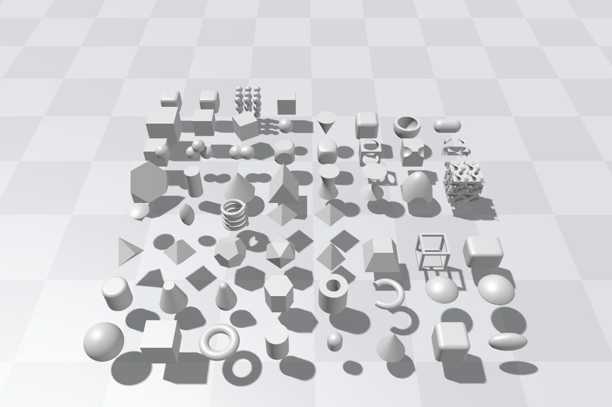

.. _Chap:LanguageShapes:

Shapes
======

Every built-in shape, with a call to copy and the names of its parts. Arguments come in the order shown, then
by name (``radius = 0.5``); a vector is ``(x, y, z)`` and an angle is in degrees. A shape's *parts* are the
pieces of its surface it tells apart, which ``.label(part = "name")`` names one by one (see
:ref:`Chap:LanguageModels`); a shape listed with one surface is labeled as a whole, ``.label("name")``.

Every shape below is used once in ``Studio/Models/gallery/model.ebg``, laid out as in the figure: open it with
``ebgstudio Models/gallery/model.ebg`` from ``Studio/`` (see :ref:`Chap:Studio`), or copy a line from it.

   ``Studio/Models/gallery``: the bounded shapes and the meshes (the four front rows), the unbounded ones inside a cube
   (the fifth row), then the operations of :ref:`Chap:LanguageOperations` (the rows behind).

Each shape is a C++ class of the library, and its name and parameters follow the class's: the class name
without ``SDF``, in snake_case (``RoundedBoxSDF`` is ``rounded_box``), and the constructor's parameters in
order, without their ``a_`` prefix. The regular solids and the pyramid are made in C++ by the static functions of
``ConvexPolyhedronSDF`` and the hyperboloids and the paraboloid by those of ``QuadricSDF``; here each is a shape of
its own name.

Bounded shapes
--------------

.. list-table::
   :header-rows: 1
   :widths: 20 50 30

   * - Shape
     - A call
     - Parts
   * - ``sphere``
     - ``sphere((0, 0, 0), 1)``: center, radius
     - one surface
   * - ``box``
     - ``box((-1, -1, -1), (1, 1, 1))``: lo_corner, hi_corner
     - xmin, xmax, ymin, ymax, zmin, zmax
   * - ``rounded_box``
     - ``rounded_box((0, 0, 0), (2, 2, 2), 0.25)``: center, size, curvature
     - xmin, xmax, ymin, ymax, zmin, zmax
   * - ``torus``
     - ``torus((0, 0, 0), 0.8, 0.25)``: center, major_radius, minor_radius (in the xz plane)
     - one surface
   * - ``capped_torus``
     - ``capped_torus((0, 0, 0), 0.8, 0.2, 270)``: center, major_radius, minor_radius, angle
     - tube, end1, end2
   * - ``cylinder``
     - ``cylinder((0, -1, 0), (0, 1, 0), 0.6)``: center1, center2, radius
     - side, cap1, cap2
   * - ``rounded_cylinder``
     - ``rounded_cylinder((0, 0, 0), 0.7, 0.2, 1.6)``: center, radius, curvature, height (along y)
     - side, cap1 (at -y), cap2 (at +y)
   * - ``capsule``
     - ``capsule((0, -0.6, 0), (0, 0.6, 0), 0.4)``: tip1, tip2, radius
     - side, tip1, tip2
   * - ``cone``
     - ``cone((0, 1, 0), 1.6, 50)``: tip, height, angle (opening toward -y)
     - side, base
   * - ``capped_cone``
     - ``capped_cone((0, -0.8, 0), (0, 0.8, 0), 0.8, 0.3)``: center1, center2, radius1, radius2
     - side, cap1, cap2
   * - ``round_cone``
     - ``round_cone((0, -0.6, 0), (0, 0.7, 0), 0.6, 0.25)``: center1, center2, radius1, radius2
     - side, end1, end2
   * - ``ellipsoid``
     - ``ellipsoid((0, 0, 0), (1, 0.6, 0.4))``: center, radii
     - one surface
   * - ``polygon_prism``
     - ``polygon_prism((0, -0.8, 0), (0, 0.8, 0), 0.8, 6, (1, 0, 0))``: center1, center2, radius, sides (3 to 4096),
       vertex_direction
     - side0 ... side(n-1), cap1, cap2
   * - ``tube``
     - ``tube((0, -0.8, 0), (0, 0.8, 0), 0.4, 0.8)``: center1, center2, inner_radius, outer_radius
     - outer, inner, end1, end2
   * - ``cut_sphere``
     - ``cut_sphere((0, 0, 0), 1, 0.4)``: center, radius, height (of the cut above the center)
     - sphere, cut
   * - ``cut_hollow_sphere``
     - ``cut_hollow_sphere((0, 0, 0), 1, 0.4, 0.15)``: center, radius, height, thickness
     - shell, rim
   * - ``tetrahedron``, ``octahedron``, ``dodecahedron``, ``icosahedron``
     - ``icosahedron((0, 0, 0), 1)``: center, radius (to a vertex), in each solid's standard orientation
     - face0 ... face(n-1)
   * - ``pyramid``
     - ``pyramid((0, -0.7, 0), (0, 0.9, 0), 0.9, 4, (1, 0, 0))``: base_center, apex, radius, sides (3 to 19),
       vertex_direction
     - side0 ... side(n-1), base
   * - ``convex_polyhedron``
     - ``convex_polyhedron(plane(...), plane(...), ...)``: 4 to 20 planes, each normal pointing out of the solid
     - face0 ... face(n-1), in the planes' order
   * - ``box_frame``
     - ``box_frame((-0.8, -0.8, -0.8), (0.8, 0.8, 0.8), 0.15)``: lo_corner, hi_corner, thickness (of a bar)
     - x00, x01, x10, x11, y00, ... z11: the bar along an axis, on the low (0) or high (1) side of the other two
   * - ``superellipsoid``
     - ``superellipsoid((0, 0, 0), (1, 0.7, 0.8), 0.3, 0.3)``: center, radii, exponent1, exponent2 (each 0.1 to 2)
     - one surface
   * - ``solid_angle``
     - ``solid_angle((0, -0.6, 0), 1.2, 70)``: center, radius, angle (opening toward +y)
     - cap, side
   * - ``vesica``
     - ``vesica((0, -1, 0), (0, 1, 0), 0.45)``: tip1, tip2, radius (at the middle)
     - one surface
   * - ``helix``
     - ``helix((0, -0.9, 0), (0, 0.9, 0), 0.7, 4, 0.12, (1, 0, 0))``: center1, center2, helix_radius, turns,
       tube_radius, start_direction
     - one surface

Unbounded shapes
----------------

These reach to infinity. Used as a model's object they would fill the scene, so they are cut by a bounded shape
(``intersection(box(...), plane(...))``), or used to cut one.

.. list-table::
   :header-rows: 1
   :widths: 20 50 30

   * - Shape
     - A call
     - Parts
   * - ``plane``
     - ``plane((0, 0, 0), (0, 1, 0))``: point, normal (pointing outside: the solid is below)
     - one surface
   * - ``infinite_cylinder``
     - ``infinite_cylinder((0, 0, 0), 0.5, "y")``: center, radius, axis (``"x"``, ``"y"`` or ``"z"``)
     - one surface
   * - ``infinite_cone``
     - ``infinite_cone((0, 1, 0), 60)``: tip, angle (opening toward -y)
     - one surface
   * - ``wedge``
     - ``wedge((0, 1, 0), 60)``: tip, angle (a knife edge along z, pointing along +y)
     - xmin, xmax
   * - ``hyperboloid``
     - ``hyperboloid((0, 0, 0), 0.4, 60)``: center, waist, angle (of the asymptotic cone; around y)
     - one surface
   * - ``hyperboloid_two_sheets``
     - ``hyperboloid_two_sheets((0, 0, 0), 0.3, 80)``: center, tip_distance, angle
     - one surface
   * - ``paraboloid``
     - ``paraboloid((0, 0.8, 0), 0.4)``: tip, tip_radius (opening toward -y)
     - one surface
   * - ``lattice``
     - ``lattice("gyroid", (1, 1, 1), 0.15)``: kind (``"gyroid"``, ``"schwarz_p"``, ``"schwarz_d"`` or ``"diamond"``,
       ``"neovius"``), cell_size, thickness (of the walls)
     - one surface
   * - ``perlin``
     - ``perlin(0.3, (2, 2, 2), 0.5, 3)``: noise_amplitude, noise_frequency, noise_persistence, noise_octaves; noise, not
       a distance
     - one surface

Meshes
------

.. list-table::
   :header-rows: 1
   :widths: 20 50 30

   * - Shape
     - A call
     - Parts
   * - ``mesh``
     - ``mesh("part.stl")``: file, kind = ``"triangles"`` or ``"polygons"``, groups = ``true``, on_defect = ``"warn"``
       or ``"throw"``, parts = ``"part.parts"``
     - its file's face groups, and the parts picked by face
   * - ``meshes``
     - ``meshes("parts/*.stl")``: pattern, then the options of ``mesh``
     - each mesh's own (a list of meshes)

A ``mesh`` reads its file (STL, PLY, OBJ, VTK) relative to the file it is written in, once per model however often it
is used. ``"triangles"`` makes a `TriMeshSDF <doxygen/html/classEBGeometry_1_1TriMeshSDF.html>`__, ``"polygons"`` a
`MeshSDF <doxygen/html/classEBGeometry_1_1MeshSDF.html>`__. With ``groups = true`` its face groups (an OBJ's ``g`` and
``o``, ...) are its parts, each labeled by its group's name. A mesh with a topology defect (an edge shared by more than
two faces, faces folding back onto each other) is read with a warning, its distance's sign unreliable near the defect;
``on_defect = "throw"`` makes it an error. A face that visits a vertex twice is an error either way.

``parts = "part.parts"`` names a parts file (relative to the file the call is in): parts of the mesh picked face by
face, which ebgstudio writes (see :ref:`Chap:StudioViewer`) for a mesh whose file names no groups, a CAD export, say.
A picked face takes its picked part; every other face keeps its file group, and a picked part named like a file group
joins it. Picked parts are labeled by their names,
whatever ``groups`` says, and ``.label(inlet = "...")`` relabels one like any part. The parts file records which
mesh it was picked on: when the mesh's faces change (a new export), reading the model is an error that names the
parts file, so that faces are picked again rather than labeled wrongly. A mesh file used by several ``mesh`` calls has
the parts of the file each call names: name the same parts file in each. The parts file must exist (ebgstudio makes
it, and adds ``parts =`` to the call, for a mesh whose call names none). ``meshes`` takes no parts file.

``meshes`` reads every file whose name matches a pattern, for an assembly kept as one file per part: ``*`` stands for
any characters and ``?`` for one, in the file's name only (the folder is written out). The files are read in natural
order (``part-2`` before ``part-10``), each as ``mesh`` reads one, and give a list (see :ref:`Sec:LanguageLists`).
A pattern that matches no file is an error.
