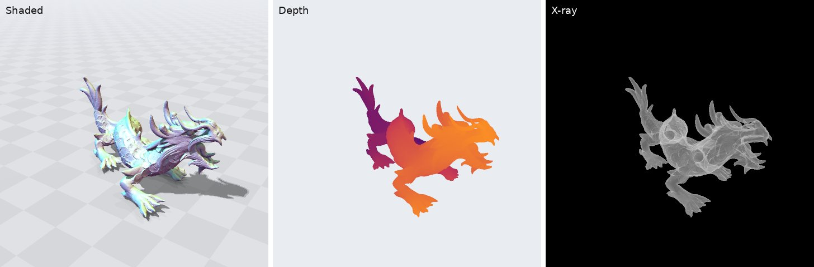

.. _Chap:Rendering:

Rendering
=========

A signed distance function can be looked at directly, without first turning it into a mesh: follow a
ray from the eye through each pixel to where it first meets the surface, and shade that point. That is a
ray query (see :ref:`Chap:Rays`): exact for the shapes and compositions that have one, sphere traced for
the rest, so the renderer works on every shape and is as exact as its ray queries are.

.. contents:: On this page
   :local:
   :depth: 1

Entering and leaving
--------------------

The first crossing along a ray may be where it enters the solid or where it leaves it: a ray that starts
inside the object (negative :math:`\phi`) first meets the surface on its way out. A ray query reports
the first crossing either way, and says which it is. This matters for what a picture shows. A hole (the
complement of a ball, say) is solid everywhere but in the ball, so a camera outside the ball sits inside
the solid, and what it sees first is where its rays leave the solid on the ball's near side. A mesh
whose faces are wound the wrong way is, to the signed distance, inside out, and looks like that too.

The renderer therefore lights a surface seen from inside from the eye's side and tints it red, and
reports how many such hits there were and whether the eye itself is in the solid. An inside-out object
cannot then pass for an outside.

Section planes
--------------

To look inside an object, the renderer can cut it with a plane, removing everything on the side the
plane's normal :math:`\mathbf{n}` points to: the intersection of the object with a half-space. The cut
is exact, whatever the object: where the plane passes through the object, the picture shows a cut face
lying on the plane. The face is partly transparent (by default; its opacity is a setting): the object's
next surface behind it (a hole, a cavity, the far wall) shows through, lit without shadows, which inside
the object would be everywhere.

The plane also shows where it slices the object. Where a ray meets the plane before anything else, the
object's value there says where the point lies: near zero, it is on the object's outline in the plane,
drawn as a line of constant width on screen; outside, a faint sheet marks the plane, within the object's
box. So a slice shows both the object's cross-section and, in front of the cut, the rest of its outline.
Lines of equal distance can be drawn as well, inside and outside: spaced like a simulation's grid, they
show which features the grid resolves.
Reversing the plane's normal removes the other side.

What a pixel shows
------------------

For a pixel, the renderer casts one ray (or :math:`n \times n` rays, averaged, which also softens the
edges of shadows) and, where it meets the surface, combines diffuse and
specular light from one direction, light from the sky, a shadow and ambient occlusion. The light's
direction is by default fixed to the camera, above and beside it, so that the side in view is lit wherever
the camera goes; it can instead be fixed in the scene. A floor under the
shape catches its shadow. Surfaces can be colored by the direction of their normal (the default),
uniformly, by primitive (by the leaf of a composed
expression the surface belongs to, or by the face of a mesh, with colors chosen per primitive or from a
palette).

The camera looks either in perspective, every ray leaving the eye, or orthographically, the rays parallel
and leaving a plane through the eye, so that sizes do not shrink with distance; a near clip starts every
ray some way from the eye, so that whatever is nearer is not seen.

Shadows and ambient occlusion are ray queries on the shape too, like the ray from the eye, so each costs
further rays wherever a pixel's ray meets the surface: turning them off (as the viewer does while the
camera moves) makes a frame much quicker.

Other views
-----------

Besides the shaded picture, the renderer has views that show what shading hides:

* **Depth** colors each pixel by how far from the eye the first surface is, from bright (near) to dark
  (far) across the shape's box. It needs only the crossing point, not the normal.
* **X-ray** shows every surface a ray crosses, all the way through the scene, on a black background: each
  glows faintly, more where it is seen edge-on, with modest highlights from the light, and partly hides what
  lies behind it, so cavities, internal walls and parts hidden behind others show through as outlines.
* **Cost** colors each pixel by what the query for one ray through its center cost, from dark (cheap) to
  bright (dear), on a log scale over the frame. There are two: the cost of finding the first hit with its normal
  and primitive, and the cost of finding only where the ray crosses the surface (see :ref:`Chap:Rays`); comparing
  them shows where a shape spends its time on the normal. Only the camera's rays are measured, without shadows or
  lighting: in nanoseconds on the host, in clock cycles on a GPU, where threads trace in groups that wait for their
  slowest ray, so that a pixel's cycles include that wait. The costs are wall-clock, so they include whatever else
  the machine was doing; they show where a shape is expensive, not a benchmark. A cost view also reports the
  frame's rays per second, which time the tracing alone (see :ref:`Chap:PerformanceTesting` for measuring).

   A mesh in the shaded view, the depth view and the x-ray view.

Any surface can also be made **see-through**: a camera ray that meets it goes on as if it were not there,
and the surface behind it is drawn as if seen from outside. Only the picture changes: shadows, ambient
occlusion and what is inside the solid are those of the whole shape. And a part's inside can be **filled**
with a translucent color, wherever it lies along a ray, in front of or behind what is seen: an electrode
inside a dielectric, say. A stretch of a ray inside the solid counts as the part's when the ray enters it
through that part's surface, so where parts of a union overlap, the overlap counts as the part the ray
entered first.

:ref:`Chap:ImplemRender` describes the classes, and :ref:`Chap:ExampleMeshSDF` opens the viewer on a mesh.
