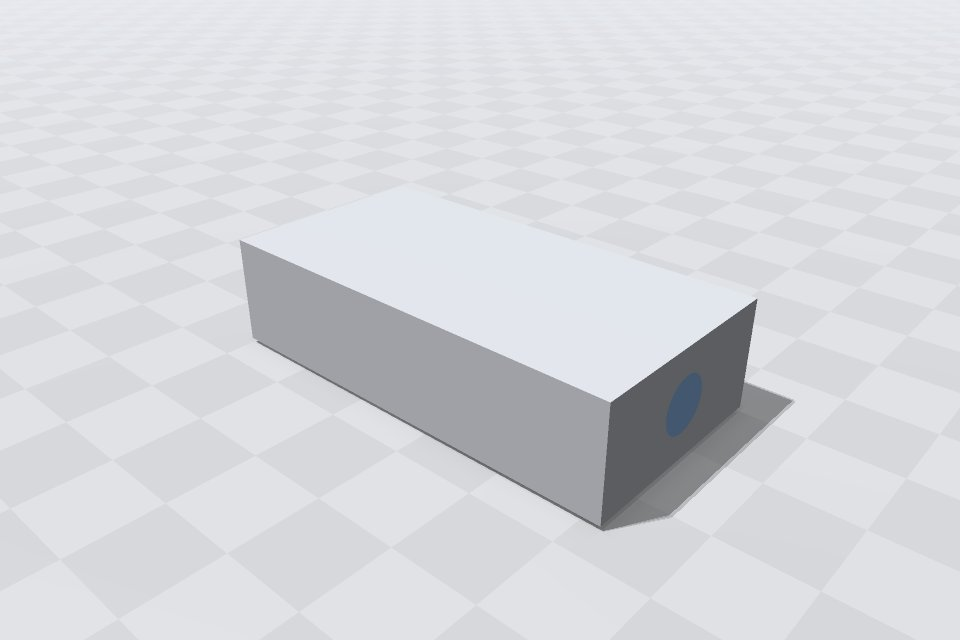

.. _Chap:StudioCoolingBlock:

Walkthrough: a cooled block
===========================

This builds ``Studio/Models/cooling_block`` step by step: a steel block heated from below and cooled by water flowing
through a channel bored along it, with the two computations a program would run on it, the water's flow and the heat in
the steel. Each step is a few lines added to the model; keep the window open (``ebgstudio mine`` in ``Studio/``) and it
shows each step as the files are saved. The finished model is in ``Studio/Models/cooling_block``.

   The finished model, as ``ebgstudio Models/cooling_block`` opens it: the steel block, and the water where the channel
   comes out of it.

1. The block
------------

A model is a folder; ``model.ebg`` holds its geometry. Start one, ``mine/model.ebg``, with the block's size as params
(values a program or ``-D`` can change) and the block itself, the model's object:

.. code-block:: text

   ebg 0

   param length    = 4
   param width     = 2
   param height    = 1
   param r_channel = 0.25

   block = box((0, 0, 0), (length, height, width))

   object block

``ebgstudio mine`` opens it; ``ebgstudio params mine`` lists the params, and ``ebgstudio mine -D length=6`` opens it
longer.

2. Labeling its faces
---------------------

The faces of the block will be the boundaries of the computations: the heated base, the top and the sides, the two
ends. A label names a shape's parts (a box's are ``xmin`` to ``zmax``, see :ref:`Chap:LanguageShapes`); a label
written on its own line keeps the shape's line short:

.. code-block:: text

   block = box((0, 0, 0), (length, height, width))
     .label(ymin = "base", ymax = "top", zmin = "side", zmax = "side", xmin = "end", xmax = "end")

``ebgstudio check mine --inventory`` lists the labels and which part has which.

3. The channel, and two regions
-------------------------------

The channel is a cylinder along the block, its caps the water's inlet and outlet. The steel and the water are two
regions of an ``overlay``, each with a material; where they overlap, the later one is: the water.

.. code-block:: text

   channel = cylinder((0, height / 2, width / 2), (length, height / 2, width / 2), r_channel)
     .label(cap1 = "inlet", cap2 = "outlet", side = "bore")

   object overlay {
     region solid = block material steel
     region water = channel material water
   }

The window colors the regions by material. ``check`` now warns that ``steel`` and ``water`` are not declared: that is
the setup's job.

4. The setup: materials
-----------------------

What is computed on the geometry goes in ``mine/setup.ebg``, read after ``model.ebg``: first the materials, with the
properties a program reads (any names; the language gives them no meaning):

.. code-block:: text

   ebg 0

   param inflow = 0.5

   material steel { conductivity = 45, density = 7850, heat_capacity = 490 }
   material water { conductivity = 0.6, density = 1000, viscosity = 1.0e-3, heat_capacity = 4180 }

5. The flow: a domain
---------------------

A domain is one computation: the regions it runs in (its subdomains) and what it does on each piece of surface that
bounds them (its surface groups). The flow runs in the water, enters at the inlet, leaves at the outlet, and sticks to
the channel's wall:

.. code-block:: text

   domain flow {
     subdomain fluid = water
     group inlet = label("inlet") { velocity = (inflow, 0, 0), temperature = 290 }
     group outlet = label("outlet") { pressure = 0 }
     group wall = interface(water, solid) { kind = "no_slip" }
   }

``ebgstudio check mine --domain flow`` says whether every piece of surface around the water is in a group. Instead of
writing the groups, they can be made in the window (see :ref:`Chap:StudioViewer`): click the domain ``flow``, start a
surface group, click the channel's inlet and press Enter; the window writes ``label("inlet")`` into the setup file.

6. The heat: a second domain
----------------------------

The heat runs in the steel: heated through the base, cooled through the channel, insulated elsewhere.
``remaining()`` takes every surface no earlier group holds:

.. code-block:: text

   domain heat {
     subdomain metal = solid
     group heated = label("base") { heat_flux = 5.0e4 }
     group cooled = interface(solid, water) { kind = "coupled" }
     group insulated = remaining() { heat_flux = 0 }
   }

7. Joining them
---------------

The heat crosses the channel's wall from one computation into the other: a coupling joins the two surface groups that
hold it, and ``check`` makes sure they hold the same surfaces:

.. code-block:: text

   couple wall_heat = surface(heat.cooled, flow.wall) { transfer = "heat" }

8. The view, and the check
--------------------------

Last, the camera and colors the window opens with:

.. code-block:: text

   view { camera = (6.5, 4, 6), target = (2, 0.5, 1), color.steel = (0.6, 0.62, 0.66), color.water = (0.3, 0.55, 0.9) }

``ebgstudio check mine --all-domains`` now reports no error and no warning, and both domains complete: the model
``Studio/Models/cooling_block`` is, and a program reads it with ``Language::read()`` (see
:ref:`Chap:ExampleLanguage`).
