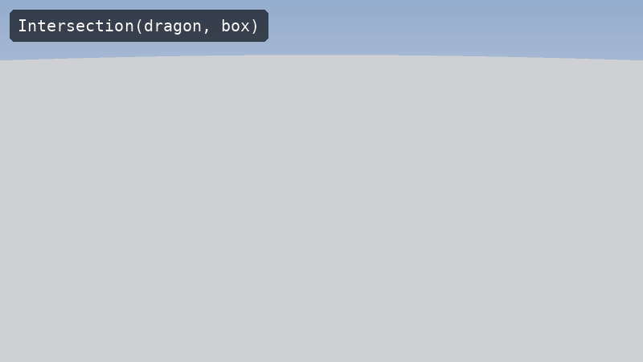

# EBGeometry

**Fast, portable geometry queries in a single C++ header.**

[](https://github.com/rmrsk/EBGeometry/actions/workflows/CI.yml?query=branch%3Adev)
[](https://rmrsk.github.io/EBGeometry/)
[](LICENSE)
[](https://en.cppreference.com/w/cpp/17)
[](EBGeometry.hpp)
[](EBGeometry.hpp)
[](https://rmrsk.github.io/EBGeometry/SIMDAcceleration.html)
[](https://rmrsk.github.io/EBGeometry/RunningOnGPU.html)
[](https://rmrsk.github.io/EBGeometry/RunningOnGPU.html)

EBGeometry turns meshes, analytic shapes, point clouds and compositions of them into geometry you
can ask questions: how far away is it, which surface is closest, where a ray hits it, what lies
nearest. It answers them fast on CPUs and on GPUs, from the same code, with no dependencies: include
one header and compile with C++17.

<p align="center">
   
   <br/>
   <sub>A 250,000-triangle mesh composed with analytic shapes: an intersection, a union, a smooth
   union and a difference. Dragon: <a href="https://graphics.stanford.edu/data/3Dscanrep/">Stanford
   3D Scanning Repository</a>.</sub>
</p>

## Why EBGeometry

* **Any geometry.** A triangle mesh read from STL, PLY, OBJ or VTK, an analytic shape, a point
  cloud, or any composition of them is queried the same way. Drill a hole through a mesh with an
  analytic cylinder, blend two shapes smoothly, or union ten thousand parts.
* **Any hardware.** The same query runs on the host (SIMD from SSE to AVX-512) and on NVIDIA and AMD
  GPUs (CUDA and HIP). Build a structure once, mirror its memory to the device, and evaluate it
  there.
* **Fast by construction.** Packed bounding volume hierarchies with any branching factor and a choice
  of builds (SAH, clustered SAH, Morton and Hilbert curves), SIMD triangle kernels, compiled CSG, and
  BVH-accelerated unions of many objects.
* **Measured on every change.** Every pull request comes with a performance comparison against its
  base, on the host and on a GPU, which also checks that the answers did not change. Unit tests check
  against brute force and closed forms, in both precisions, under sanitizers.
* **No dependencies.** One header, C++17, `float` or `double`. Nothing to build or link.

## What it does

**Geometry in**

* Triangle meshes, as a half-edge mesh or as SIMD triangle blocks, read from STL, PLY, OBJ and VTK.
* Analytic shapes (spheres, boxes, cylinders, tori, planes and more) and your own.
* Point clouds.

**Composition**

* Constructive solid geometry: unions, intersections, differences, smooth blends, offsets,
  repetitions, and translations, rotations and scalings.
* A scene compiled into a *tape* that runs on a GPU, or a part fused into compiled code.
* BVH-accelerated unions of thousands of objects.

**Queries**

* Signed distance (negative inside, positive outside), normals, and bounding boxes.
* The primitive that decides the value at a point, with the point in its own frame.
* Ray and segment hits (`firstHit()`, `intersects()`): exact for meshes and closed-form shapes, sphere
  traced for everything else.
* Closest points and k nearest neighbours in point clouds.

## In code

```cpp
#include <iostream>

#include <EBGeometry.hpp>

using namespace EBGeometry;
using T = float;

// A query, as a trivially copyable functor: the same code runs on the host and in a GPU kernel.
struct Distance
{
  Tape<T> m_scene;

  EBGEOMETRY_HOST_DEVICE T
  operator()(const Vec3T<T>& a_point) const noexcept
  {
    return m_scene.signedDistance(a_point);
  }
};

int
main()
{
  Pool pool(hostMemoryResource());

  // A triangle mesh as a signed distance field: SIMD triangle blocks under a BVH.
  const auto mesh = Parser::readIntoTriMeshSDF<T>("armadillo.obj", pool);

  // Place the other shapes from the mesh's bounding box: the armadillo is about 130 units across.
  const auto     box    = mesh.computeBoundingVolume();
  const Vec3T<T> center = box.getCentroid();
  const Vec3T<T> beside(box.getHighCorner()[0] + T(30), center[1], center[2]);

  // A scene: the mesh drilled through along x (axis 0) by a cylinder of radius 10, and beside it a
  // smooth blob of two spheres. Compiled into a tape.
  const auto drill = InfiniteCylinderSDF<T>(center, T(10), 0);
  const auto big   = SphereSDF<T>(beside, T(15));
  const auto small = SphereSDF<T>(beside + Vec3T<T>(T(20), T(0), T(0)), T(10));
  const auto blob  = SmoothUnion(big, small, T(5));

  const Tape<T> scene(pool, Union(Difference(Expr<T>(mesh), drill), blob));

  // Ask it anything, anywhere: here, at a point in the blob.
  const Vec3T<T>        p    = beside;
  const T               d    = scene.signedDistance(p);    // negative inside, positive outside
  const PrimitiveRef<T> leaf = scene.closestPrimitive(p);  // which surface decides the value

  std::cout << "distance " << d << ", decided by leaf " << leaf.m_leaf << '\n';

  // The same query on a GPU: mirror the pool to the device and evaluate a million points in a kernel.
  std::vector<Vec3T<T>> points(1000000, p);
  std::vector<T>        distances(points.size());

  pool.freeze();

  const Pool device = Pool::mirror(pool, GPU::memoryResource());

  GPU::transform(Distance{scene.rebasedView(device)}, points, distances);
}
```

Compiled as plain C++, `GPU::transform()` runs the same functor in a host loop; compiled with nvcc or
hipcc, it runs it in a kernel. The [examples](https://rmrsk.github.io/EBGeometry/Examples.html) walk
through each part of this, one topic at a time.

## How it compares

EBGeometry overlaps with several excellent libraries:
[TriangleMeshDistance](https://github.com/InteractiveComputerGraphics/TriangleMeshDistance) and
[fcpw](https://github.com/rohan-sawhney/fcpw) for mesh distances, [libfive](https://libfive.com) for
functional solid modelling, [nanoflann](https://github.com/jlblancoc/nanoflann) for neighbour search,
[Embree](https://www.embree.org) and [OptiX](https://developer.nvidia.com/rtx/ray-tracing/optix) for
ray tracing, and [CGAL](https://www.cgal.org) for exact computational geometry. What it adds is the
combination: every kind of geometry, composed freely, queried the same way on CPUs and GPUs, from one
header. [EBGeometry-benchmarks](https://github.com/rmrsk/EBGeometry-benchmarks) measures it beside
several of them.

EBGeometry was written for embedded-boundary codes such as [AMReX](https://amrex-codes.github.io)
and [Chombo](https://commons.lbl.gov/display/chombo); [`Integrations/`](Integrations/README.md)
shows how to couple it to them. It is general-purpose.

## Get started

Clone the repository, including the submodule that provides the example mesh files:

```bash
git clone --recurse-submodules https://github.com/rmrsk/EBGeometry.git
cd EBGeometry
```

Build and run the `MeshSDF` example, which reads a triangulated surface mesh and evaluates it as a
signed distance function:

```bash
cd Examples/MeshSDF
g++ -std=c++17 -O3 -march=native -I../.. main.cpp -o MeshSDF.ex
./MeshSDF.ex
```

This loads `armadillo.obj` from the `common-3d-test-models` submodule by default; pass a path to run
it on a different STL/PLY/OBJ/VTK file instead. Every example under `Examples/` can also be built with
[CMake](https://cmake.org/) or GNU make (see [Examples/MeshSDF/README.md](Examples/MeshSDF/README.md)),
and with `make GPU=CUDA` or `make GPU=HIP` for a GPU.

To build and run the whole test suite and every example, use the
[CMake presets](https://cmake.org/cmake/help/latest/manual/cmake-presets.7.html):

```bash
cmake --preset debug                # Debug, assertions on, tests and examples
cmake --build --preset debug --parallel $(nproc)

ctest --preset debug                # unit tests (Catch2), about 15 seconds
ctest --preset examples --parallel $(nproc)   # every example, several minutes in Debug
```

See [Contributing and testing](https://rmrsk.github.io/EBGeometry/Contributing.html) for the full
preset table, the sanitizer and release builds, and `Scripts/run-all-checks.sh`, which runs everything
the continuous integration pipeline checks in one local command.

## Documentation

* [User guide (HTML)](https://rmrsk.github.io/EBGeometry/): concepts, building, examples, and
  testing.
* [User guide (PDF)](https://rmrsk.github.io/EBGeometry/ebgeometry.pdf): the same, as one file.
* [API reference (Doxygen)](https://rmrsk.github.io/EBGeometry/doxygen/html/index.html): every class
  and function.

The documentation is rebuilt on every pull request and evolves with the code.

## Get help

* [GitHub issues](https://github.com/rmrsk/EBGeometry/issues): bug reports and feature requests.
* [GitHub discussions](https://github.com/rmrsk/EBGeometry/discussions): usage questions and
  everything else.

## Contribute

Contributions are welcome. Reach out to see whether a feature is already planned, or fork the
repository and open a pull request. See
[Contributing and testing](https://rmrsk.github.io/EBGeometry/Contributing.html) for how to build and
test locally, what continuous integration checks, the performance comparison every pull request
carries, and the code conventions. For GPU work, start from [PORTING.md](PORTING.md).

## How EBGeometry is developed

EBGeometry is human-designed, with AI-assisted implementation.

* **2022 to mid-2026:** designed and written by hand.
* **Since July 2026** (the overhaul in [#88](https://github.com/rmrsk/EBGeometry/pull/88)): the
  maintainer designs and decides: the architecture, the APIs, the algorithms, the priorities, and
  every non-obvious choice. [Claude Code](https://claude.com/claude-code) implements, tests, documents
  and measures, steered by the rules in [`CLAUDE.md`](CLAUDE.md), and brings every open decision back
  to the maintainer.
* **Every change,** whoever wrote it, passes the same gates: unit tests against independent
  references, continuous integration, a performance comparison against its base, an AI review, and a
  human review. The maintainer reviews and merges every pull request.

Contributions written with an AI coding agent are welcome on the same terms.
