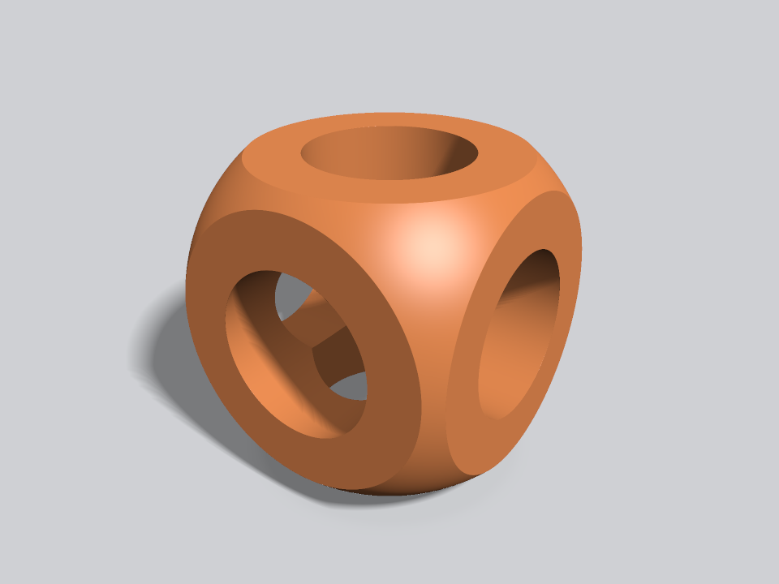
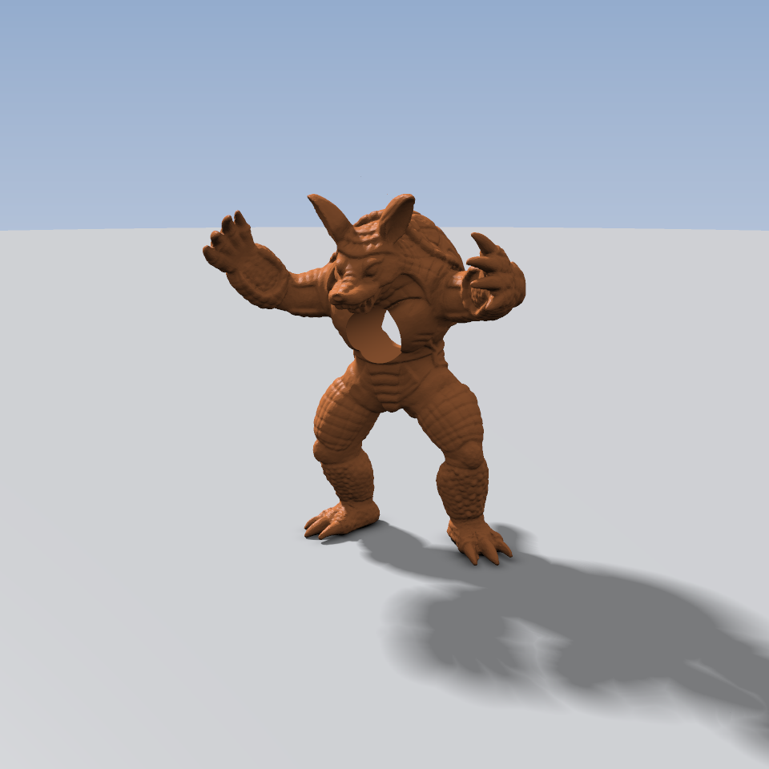
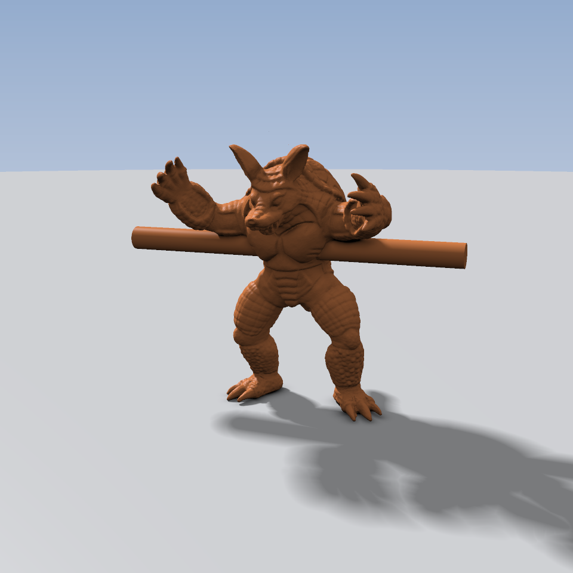
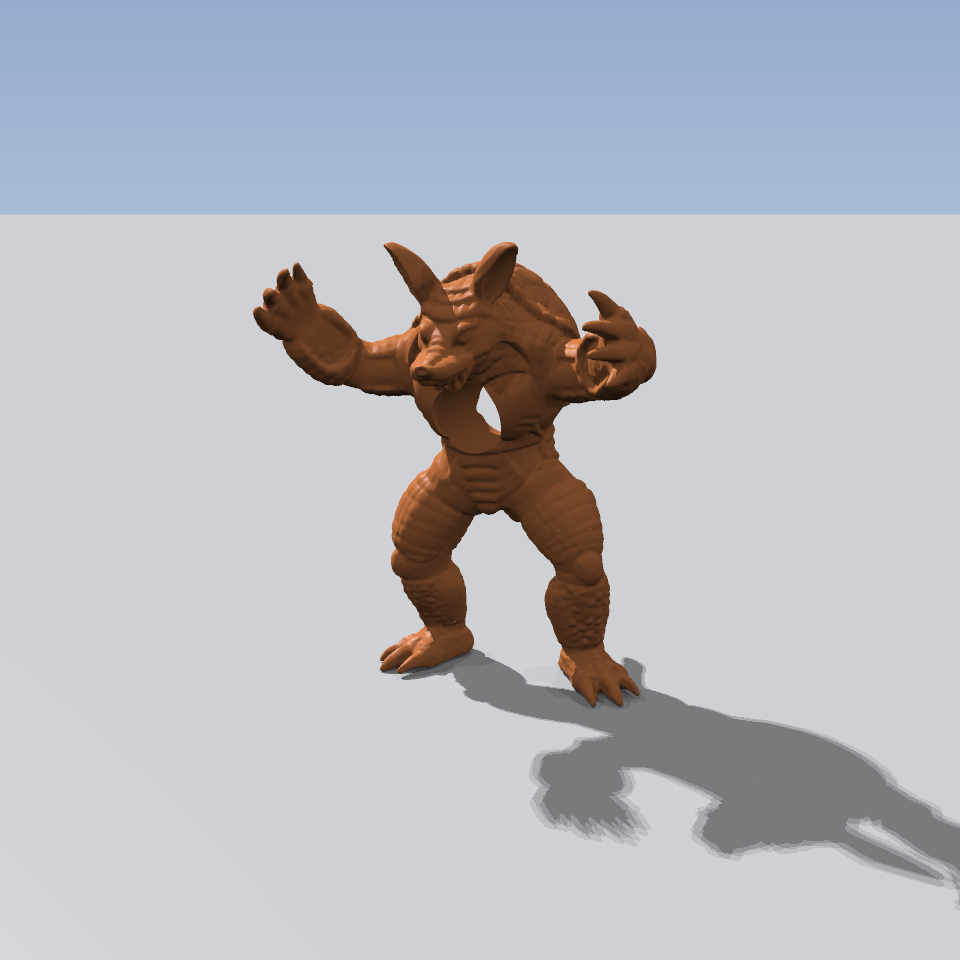
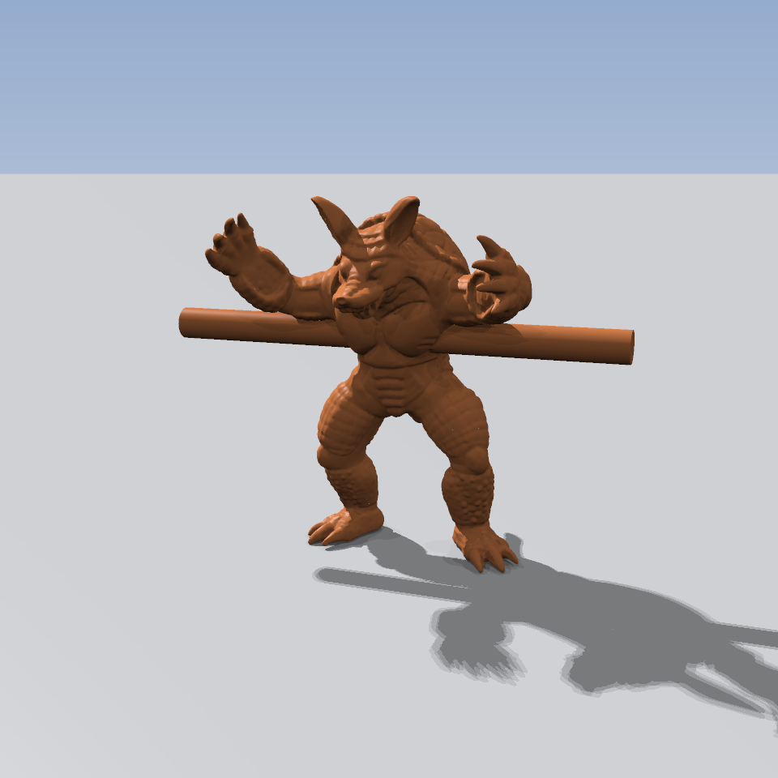

<!--
SPDX-FileCopyrightText: 2026 Robert Marskar <robert.marskar@sintef.no>

SPDX-License-Identifier: GPL-3.0-or-later
-->

# Scratch: a sphere tracer for EBGeometry shapes

Prototype for issue #93 (visualization by sphere tracing). Not part of the library, not built by CMake
or CI.

| File | What it is |
|---|---|
| `Tracer.hpp` | Orbit camera, sphere tracer, shading (diffuse, specular, sky, soft shadow, AO), the `Pixel` functor (host and device), `classicCSG()` |
| `render.cpp` | Writes one still image, `csg.ppm` (`./render [yaw] [pitch]`) |
| `viewer.cpp` | SDL2 window (`./viewer`, `./viewer tunnel <armadillo.obj>`, `./viewer rod <armadillo.obj>`): left-drag orbits, wheel zooms, `S`/`A`/`F` toggle shadows/AO/floor, `G` GPU/CPU, `M` ray tracing / hybrid / sphere tracing (Armadillo scenes), `R` reset |
| `armadillo.cpp` | The Armadillo (`common-3d-test-models`) pierced by a cylinder: a tunnel (`Difference`) or a rod (`Union`), rendered through `GPU::transform()`. `MESH=tri` uses a `TriMeshSDF`, `BOXBOUND=1` steps by the distance to the bounding box far from it |
| `RayTracer.hpp` | A ray tracer for the Armadillo scenes: a `PackedBVH` over the triangles traversed with a ray-box test (`PackedBVH::traverse()`), Moller-Trumbore, a closed-form capped cylinder, and CSG by walking the ray's crossings in order; plus the hybrid (rays walk a BVH of boxes covering the surface, the tape is sphere traced inside the boxes they enter) |
| `rtarmadillo.cpp` | The Armadillo scenes rendered by sphere tracing, pure ray tracing and the hybrid (leaf sizes 8, 32, 128), with and without the tape, timed on the GPU |
| `RayTracer.hpp` | A ray tracer for the Armadillo scenes: a `PackedBVH` over the triangles traversed with a ray-box test (`PackedBVH::traverse()`), Moller-Trumbore, a closed-form capped cylinder, and CSG by walking the ray's crossings in order; plus the hybrid (rays walk a BVH of boxes covering the surface, the tape is sphere traced inside the boxes they enter) |
| `rtarmadillo.cpp` | The Armadillo scenes rendered by sphere tracing, pure ray tracing and the hybrid (leaf sizes 8, 32, 128), with and without the tape, timed on the GPU |
| `meshbench.cpp` | Distance evaluations per pixel, and the GPU cost of one mesh distance query near the surface, inside the box and far away (`MeshSDF`, `TriMeshSDF`, a `Tape`) |
| `bench.cpp` | Frame times on the host (OpenMP) and through `GPU::transform()`, tape vs. a hand-written SDF (issue #210) |



| `./armadillo armadillo.obj tunnel` | `./armadillo armadillo.obj rod` |
|---|---|
|  |  |

Ray traced (`rtarmadillo`), 17 ms per 960x960 frame with 2x2 supersampling on an RTX 3080 Ti:

|  |  |
|---|---|

Ray traced (`rtarmadillo`), 17 ms per 960x960 frame with 2x2 supersampling on an RTX 3080 Ti:

|  |  |
|---|---|

## Building

```bash
# Host (OpenMP)
g++ -std=c++17 -O3 -march=native -fopenmp -I.. render.cpp -o render
g++ -std=c++17 -O3 -march=native -fopenmp -I.. viewer.cpp -o viewer $(sdl2-config --cflags --libs)

# CUDA: compile with nvcc, link with the host compiler. nvcc rejects -march=native in the host flags
# (GCC's AMX intrinsics), and -x cu applies to every file after it, so compile with -c first.
nvcc -std=c++17 -O3 -arch=sm_86 -Xcompiler -fopenmp $(sdl2-config --cflags) -I.. -x cu -c viewer.cpp -o viewer-gpu.o
g++ viewer-gpu.o -o viewer-gpu $(sdl2-config --libs) -L$CUDA_HOME/lib64 -lcudart -fopenmp
```
